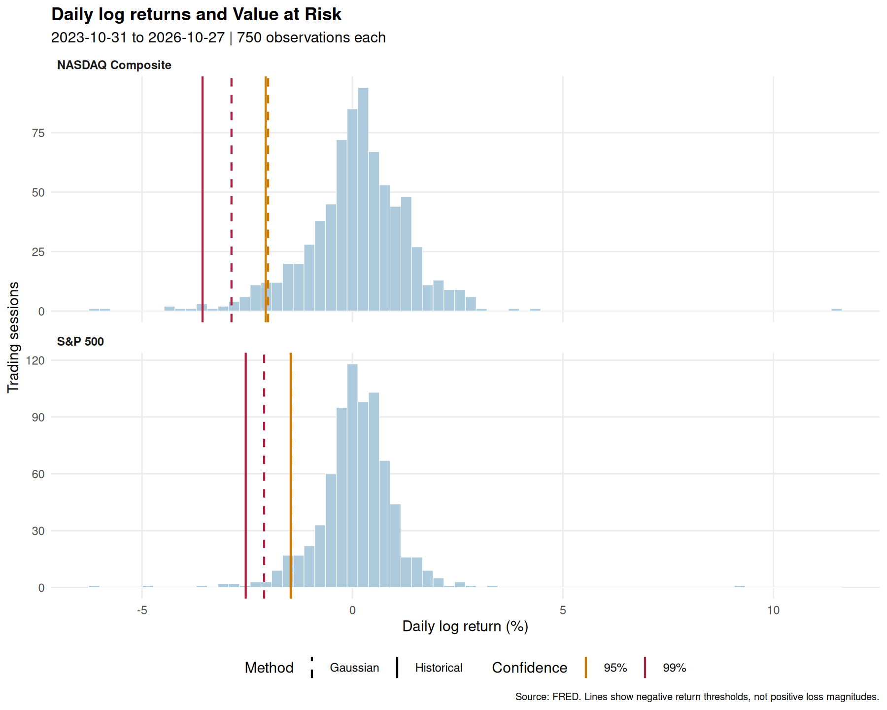

# risk-management-hw1

Практичне заняття №2. Методичний інструментарій ризик-орієнтованого управління фінансовими установами.

**Виконала:** Кириченко Ангеліна Вадимівна.

## Мета та обрані ряди

Розрахувати одноденні VaR та Expected Shortfall для S&P 500 і NASDAQ Composite за останні три роки. Індекси використано як два ринкові об’єкти аналізу; вони не є окремими акціями чи безпосередньо придбаними інструментами.
Джерело щоденних рівнів закриття — FRED (первинні джерела: S&P Dow Jones Indices LLC та Nasdaq, Inc.). Ряди відображають рух цін, без реінвестування дивідендів. Yahoo Finance повертав HTTP 429 під час підготовки, тому використано інше відкрите джерело; це не дані AAPL.

Дата зрізу: **2026-10-28**. Запитаний інтервал цін: **2023-10-28 — 2026-10-27**. Поточна незавершена сесія виключена.
Фактичний спільний інтервал дохідностей: **2023-10-31 — 2026-10-27**, по **750** спостережень на індекс.

## Структура

- `scripts/main_analysis.R` — завантаження, очищення, розрахунки, перевірки, графіки та оновлення README.
- `data/*_prices.csv` — знімок вхідних рівнів закриття з пропусками у неторгові дні.
- `data/log_returns.csv` — очищені логарифмічні дохідності на спільних датах.
- `data/risk_metrics.csv` — метрики без округлення, у частках одиниці.
- `data/data_quality.csv` — дати, кількість рядків, вилучені пропуски та контрольні суми входів.
- `data/input_manifest.csv`, `data/analysis_metadata.csv` — джерело, спосіб завантаження та параметри вибірки.
- `data/var_chart.png`, `data/var_chart_*.png` — спільна й окремі гістограми з чотирма лініями VaR.
- `data/sessionInfo.txt` — версії R і пакетів; `.gitignore` — шаблон R; `.Rproj` — проєкт RStudio.

## Запуск

Встановіть R, RStudio та Git. Відкрийте `risk-management-hw1.Rproj`. Перший запуск за потреби встановить `quantmod`, `PerformanceAnalytics` та `ggplot2` із CRAN, тому потрібен інтернет. Далі для збереженого знімка даних мережа не потрібна.

У консолі RStudio з кореня проєкту:

```r
source("scripts/main_analysis.R", encoding = "UTF-8")
```

Або в терміналі:

```sh
Rscript scripts/main_analysis.R --cached
# Оновити з FRED до останньої завершеної дати та перерахувати все:
Rscript scripts/main_analysis.R --refresh
```

Режим за замовчуванням повторно використовує повний знімок. `--cached` вимагає його наявності; `--refresh` завантажує дані наново та оновлює дату зрізу. Для відтворення наведених нижче чисел використовуйте `--cached`.

## Методика

Логарифмічна дохідність: `r_t = ln(P_t / P_(t-1))`. Неторгові записи NA вилучаються перед розрахунком, після чого дохідності очищаються та узгоджуються за спільними торговими датами. Нулі замість пропусків не підставляються, викиди не видаляються.

Позначимо рівень довіри як p, а лівохвостову ймовірність як alpha = 1 - p:

- Historical VaR: `-quantile(r, alpha)`, квантиль R type=7; виклик `VaR(..., method="historical", invert=FALSE)`.
- Gaussian VaR: `-mu - sigma * qnorm(alpha)`; `VaR(..., method="gaussian", invert=FALSE)`.
- Historical ES: оцінка середньої втрати в лівому хвості за історичним розподілом; `ES(..., p=.95, method="historical", invert=FALSE)`.
- Gaussian ES: `-mu + sigma * dnorm(qnorm(alpha)) / alpha`; доданий для порівняння двох методів ES.

Тут `mu = mean(r)`, а `sigma = sqrt(mean((r - mu)^2))`: реалізація PerformanceAnalytics використовує другий центральний момент із дільником n. Історичний ES у пакеті — мінус середнє спостережень, строго менших за історичний квантиль 5%. У скрипті всі шість метрик перевіряються також прямими формулами.

У таблиці всі метрики подано як **додатну величину одноденної втрати у відсотках логарифмічної дохідності**. Це не максимальний можливий збиток. На гістограмі відповідні пороги від’ємні. Точне переведення величини v у відсоток падіння вартості: `100 * (1 - exp(-v))`, де v — метрика у частках одиниці; таблиця цього перетворення не застосовує.

## Результати

| Індекс | Hist VaR 95% | Hist VaR 99% | Normal VaR 95% | Normal VaR 99% | Hist ES 95% | Normal ES 95% |
|---|---:|---:|---:|---:|---:|---:|
| S&P 500 | 1.467% | 2.536% | 1.459% | 2.098% | 2.143% | 1.851% |
| NASDAQ Composite | 2.061% | 3.562% | 2.004% | 2.874% | 2.930% | 2.537% |



## Висновки та обмеження

За історичним ES 95% більший хвостовий ризик у цій вибірці має **NASDAQ Composite**. Це висновок лише для наведеного періоду й обраної метрики.
VaR 99% перевищує VaR 95%, а ES 95% перевищує відповідний VaR 95%: ES враховує тяжкість втрат за порогом. Нормальна й історична оцінки різняться, бо перша припускає нормальний розподіл, а друга спирається на фактичну вибірку.
VaR 95% означає, що за моделлю поріг може бути перевищено приблизно в 5% торгових днів; це не гарантія майбутньої частоти. ES 95% характеризує середню хвостову втрату, а не ще один рівень довіри. За три роки хвіст 1% містить мало спостережень, тому VaR 99% чутливий до окремих кризових днів.
Показники не річні та не портфельні: кожний індекс оцінено окремо. Не враховано комісії, ліквідність, валютний ризик та зміну режиму ринку. Формальний бек-тест на незалежній вибірці не проводився; модель нормальності статистично не доводилася.

## Git, GitHub і здача

Репозиторій: https://github.com/AnGELina-Kyrychenko/risk-management-hw1

README, R-скрипт, дані та графіки збережено у Git. Надсилання посилання викладачу виконується окремо після власного перегляду роботи.

Для клонування на особистому ПК: RStudio → File → New Project → Version Control → Git. Вставте URL нижче, оберіть папку й натисніть Create Project:

```text
https://github.com/AnGELina-Kyrychenko/risk-management-hw1.git
```

Після змін позначте потрібні файли Staged у панелі Git, виконайте Commit зі змістовним повідомленням і Push. Аналогічно у терміналі:

```sh
git status
git add scripts/main_analysis.R data README.md
git commit -m "feat: refresh VaR and ES analysis"
git push
```

## Джерела

1. S&P Dow Jones Indices LLC. S&P 500 [SP500], FRED: https://fred.stlouisfed.org/series/SP500
2. Nasdaq, Inc. NASDAQ Composite [NASDAQCOM], FRED: https://fred.stlouisfed.org/series/NASDAQCOM
3. quantmod: https://search.r-project.org/CRAN/refmans/quantmod/html/getSymbols.FRED.html
4. PerformanceAnalytics, VaR: https://search.r-project.org/CRAN/refmans/PerformanceAnalytics/html/VaR.html
5. PerformanceAnalytics, ES: https://search.r-project.org/CRAN/refmans/PerformanceAnalytics/html/ES.html
6. Шаблон .gitignore для R: https://github.com/github/gitignore/blob/main/R.gitignore

Права на вхідні індексні дані належать їхнім правовласникам; відкритий доступ до FRED не означає передачі цих прав. Проєкт є навчальним. AI використано як помічника для підготовки коду й пояснень; наведені числа отримано виконанням R-скрипту, а не згенеровано як приклад.
